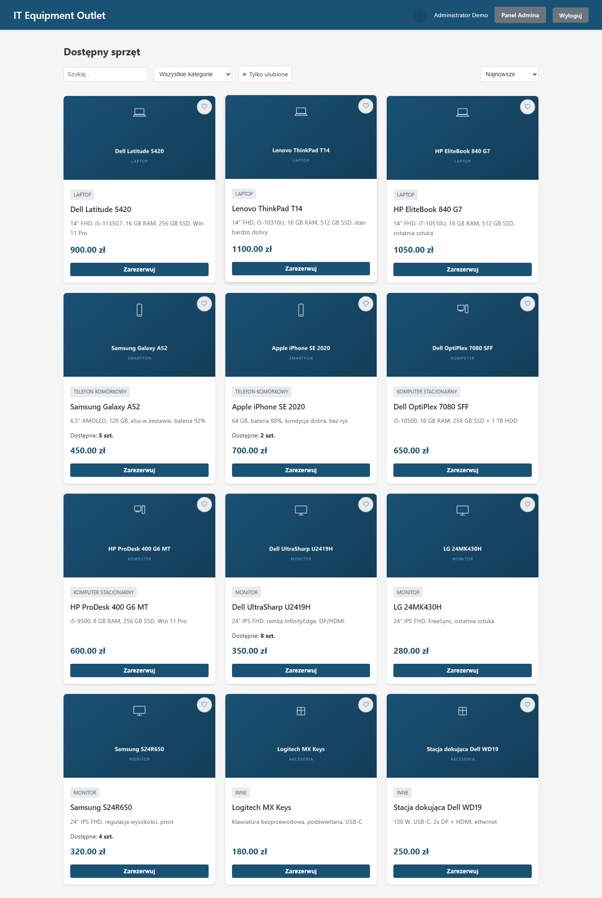
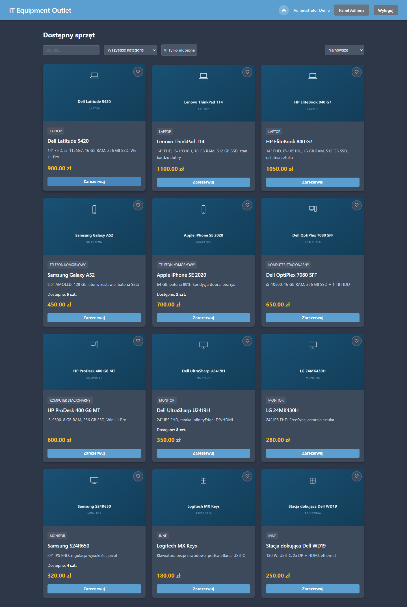
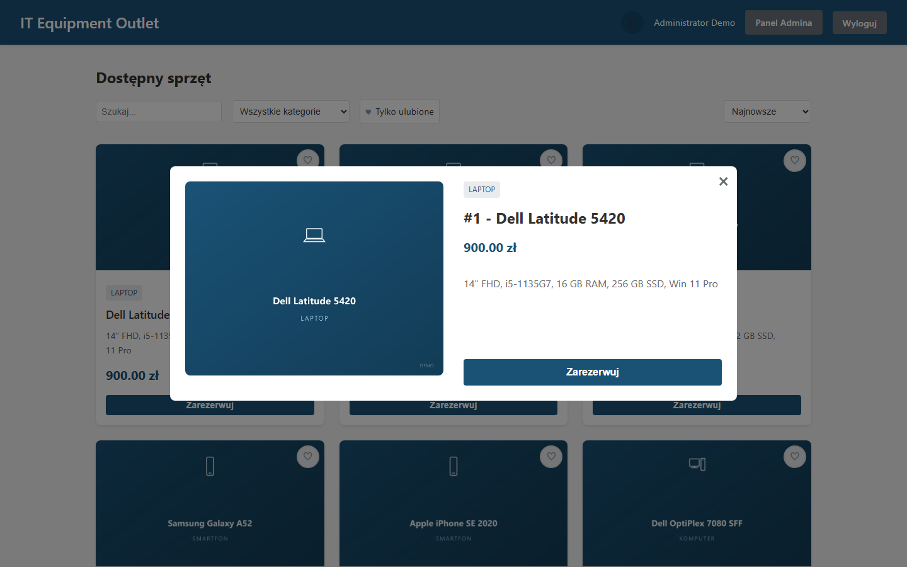
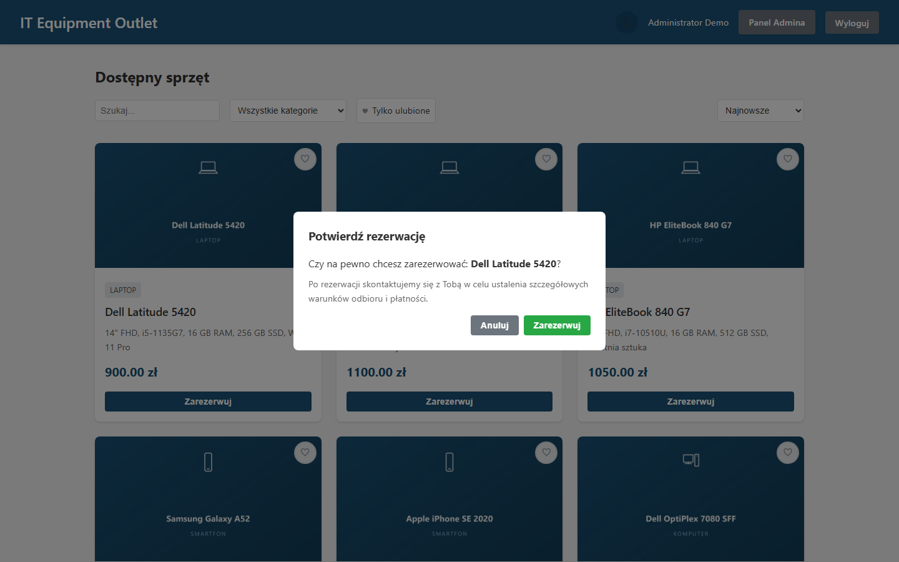
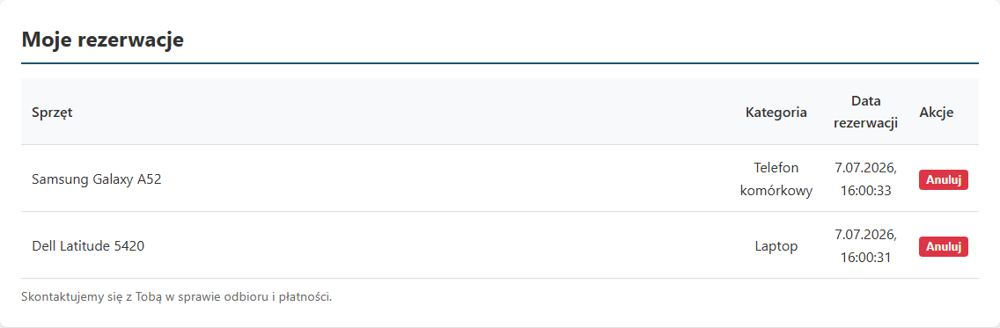
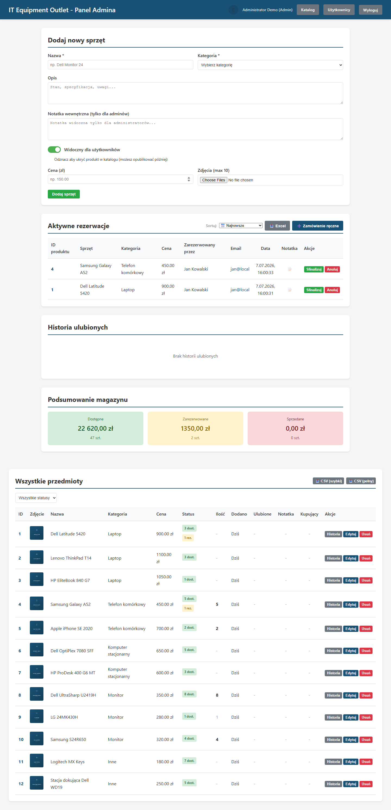
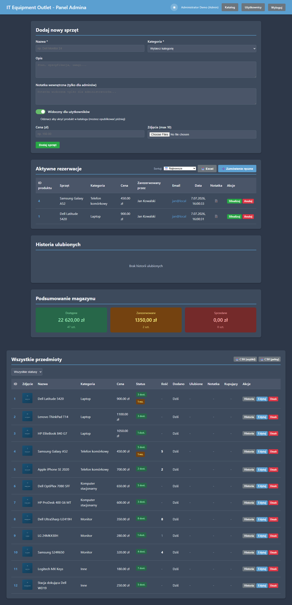
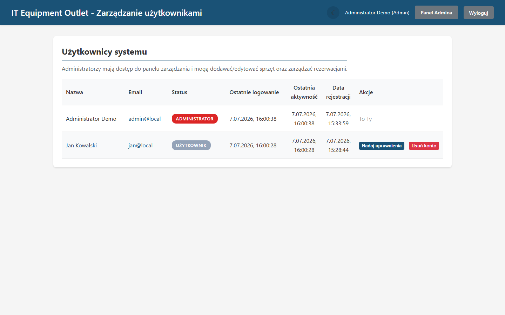
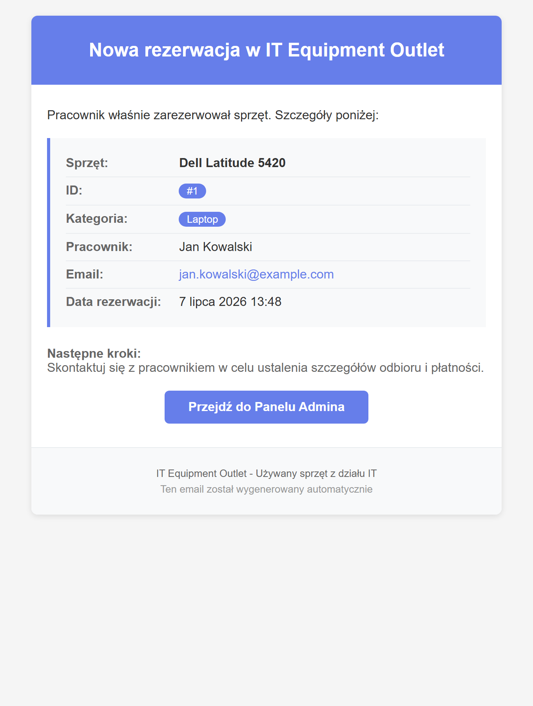
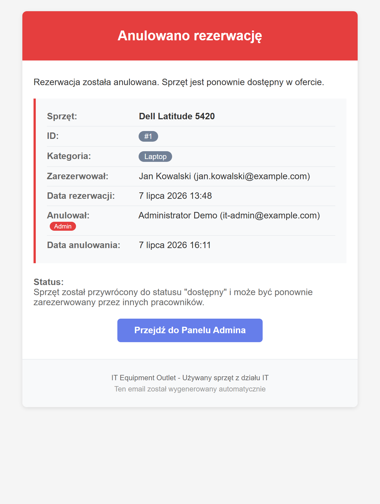

# IT Equipment Outlet

[](https://github.com/wasilewskimaciej/it-equipment-outlet/actions/workflows/ci.yml)
[](https://github.com/wasilewskimaciej/it-equipment-outlet/actions/workflows/codeql.yml)

A web application for an internal company store where employees browse and reserve
surplus / used IT equipment, and administrators manage the catalogue and fulfil orders.

The store fills a gap in the hardware lifecycle: equipment that is too good to be
scrapped, yet too old, too slow or slightly flawed to be redeployed to another
employee. Instead of being written off, it gets a second life with the company's
own staff.

> **About this project.** This is a real, working internal tool, generalized into a
> self-contained portfolio build. All data in the screenshots is synthetic — there is
> no real company data, catalogue or user information in this repository.

## Tech Stack

- **Backend:** Node.js, Express, TypeScript
- **Database:** SQLite (better-sqlite3)
- **Auth:** Microsoft Entra ID (Azure AD) + local accounts with bcrypt
- **Frontend:** Vanilla JS, CSS (no frameworks)
- **Email:** Nodemailer (SMTP notifications)
- **Testing:** Vitest

## Features

- Product catalogue with search, filtering and pagination
- Reservation system with per-user limits
- Admin panel — manage items, reservations and users
- Manual admin orders with percentage / fixed-amount discounts
- Image upload with magic-byte validation
- Email notifications (reservation, cancellation, rights change)
- Rate limiting on sensitive endpoints
- Audit logging (structured JSON)
- Security headers (CSP, X-Frame-Options, X-Content-Type-Options)
- Same-origin CSRF protection
- Dark mode, responsive design
- XLSX data export

## Screenshots

Catalogue (light / dark):

<table>
  <tr>
    <td></td>
    <td></td>
  </tr>
</table>

Item details &nbsp;·&nbsp; reservation dialog:

<table>
  <tr>
    <td></td>
    <td></td>
  </tr>
</table>

My reservations:



Admin panel (light / dark):

<table>
  <tr>
    <td></td>
    <td></td>
  </tr>
</table>

User management:



Email notifications (reservation / cancellation):

<table>
  <tr>
    <td></td>
    <td></td>
  </tr>
</table>

The full set (20 screenshots, light + dark + all email templates) lives in [`docs/screenshots/`](docs/screenshots/).

## Quick Start

```bash
# Clone
git clone https://github.com/wasilewskimaciej/it-equipment-outlet.git
cd it-equipment-outlet

# Install dependencies
npm install

# Configure
cp .env.example .env
# Edit .env — minimum: SESSION_SECRET and LOCAL_ACCOUNTS

# Run (development)
npm run dev

# Run (production)
npm run build
npm start
```

The app will be available at `http://localhost:3000`.

**Local accounts (no Azure needed).** For local testing you can skip Microsoft Entra ID
entirely and log in with local accounts defined in `LOCAL_ACCOUNTS` (see `.env.example`
for the format and how to generate the bcrypt hash).

## Architecture

```
src/
├── server.ts              # Express setup, middleware, static files
├── config.ts              # Configuration loaded from .env
├── auth.ts                # Passport.js (Azure AD + local strategy)
├── db.ts                  # SQLite schema, migrations, data access
├── email.ts               # Email templates and SMTP delivery
├── logger.ts              # Structured JSON logging
├── utils.ts               # Shared utilities (escapeHtml)
├── middleware/
│   ├── auth.middleware.ts      # requireAuth, requireAdmin
│   └── activity.middleware.ts  # User activity tracking
├── routes/
│   ├── auth.routes.ts          # Login / logout / callback
│   ├── items.routes.ts         # Item CRUD + image upload
│   ├── reservations.routes.ts  # Reservations + admin orders
│   ├── favorites.routes.ts     # Favorites
│   └── users.routes.ts         # User management (admin)
└── services/
    └── thumbnail.ts            # Image thumbnail generation

public/                    # Frontend (vanilla JS + CSS)
tests/                     # Vitest tests
```

## API

Full REST API documentation: [API.md](API.md)

## License

Released under the [MIT License](LICENSE) © 2026 Maciej Wasilewski.
